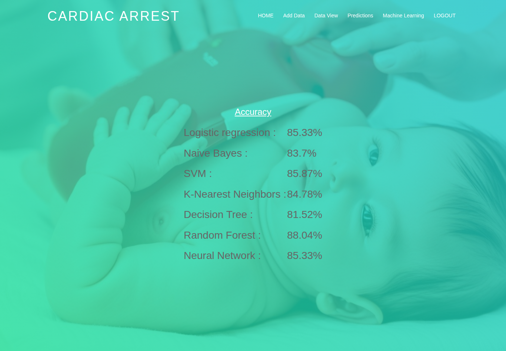
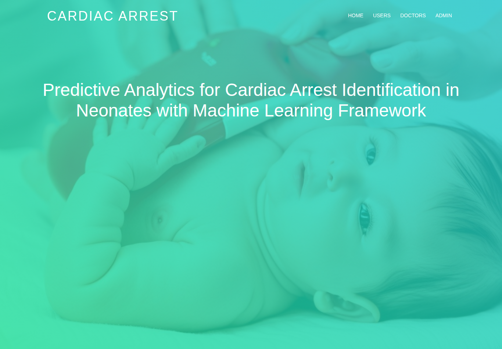
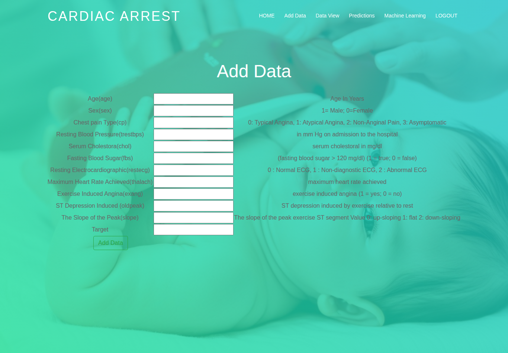
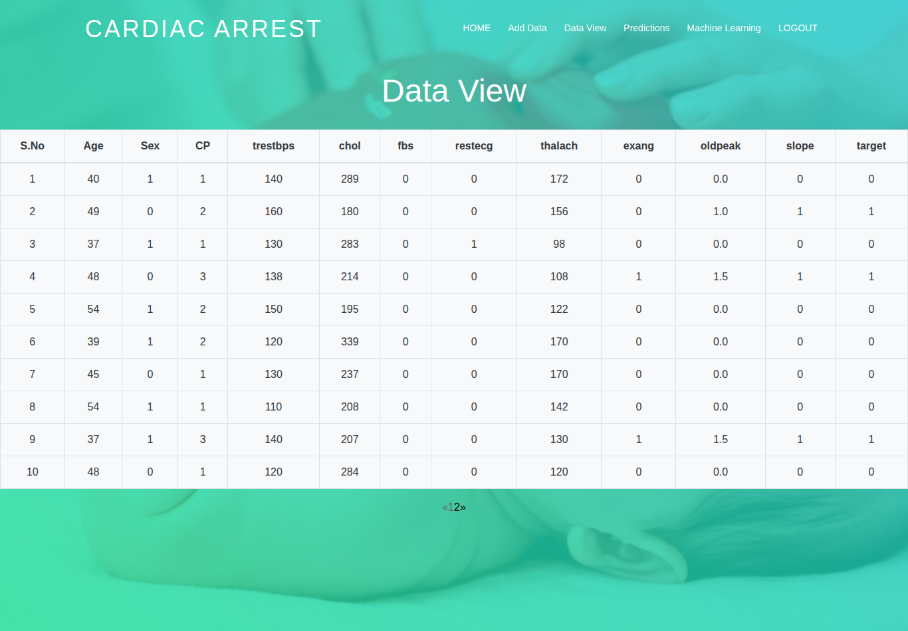
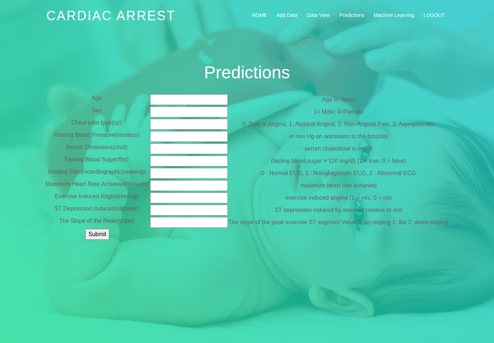
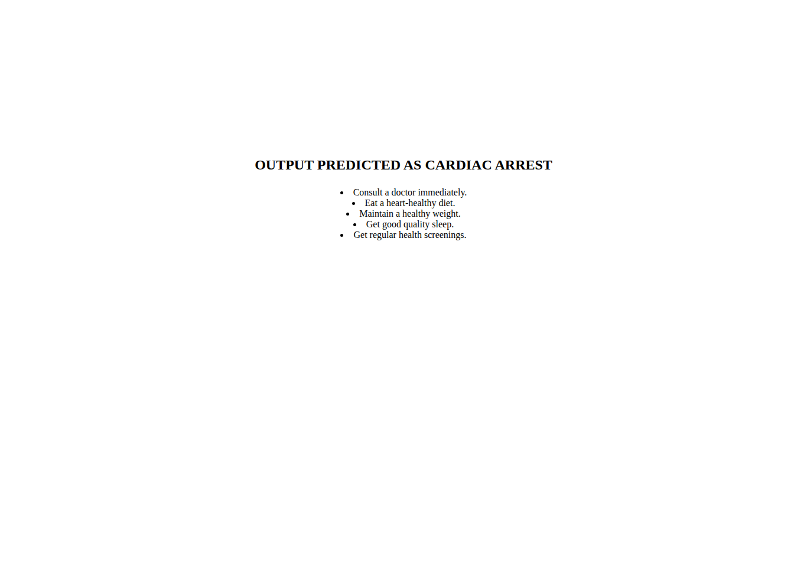

# Cardiac Arrest Prediction using Machine Learning

A Django web application that predicts cardiac arrest / heart disease risk from 11 clinical attributes, comparing **seven machine learning models** trained on a combined dataset of **918 patient records**. Built as a B.Tech major project at GRIET, Hyderabad, and published in IJAEMA (Dec 2023).



## Results (verified, 80/20 split, seed 42)

| Model | Accuracy |
|---|---|
| **Random Forest** | **88.04%** |
| SVM (RBF kernel, scaled) | 85.87% |
| Neural Network (Keras) | 85.87% |
| Logistic Regression | 85.33% |
| K-Nearest Neighbors | 84.78% |
| Naive Bayes (Gaussian) | 83.70% |
| Decision Tree | 81.52% |

Models are retrained live on every visit to the Machine Learning page — nothing is pre-trained. Preprocessing: impossible zero readings (cholesterol / resting BP = 0, i.e. "not recorded") are treated as missing and median-imputed; features are scaled for the distance/margin-based models. Naive Bayes deliberately trains on raw values (imputation measurably hurts it).

## Dataset
"Heart Failure Prediction" dataset (fedesoriano, Kaggle 2021), compiled from five public sources — Cleveland (303), Hungarian (294), Switzerland (123), Long Beach VA (200) and Statlog (270); duplicates removed → **918 records (508 with heart disease, 410 without), 11 features**: age, sex, chest pain type, resting BP, cholesterol, fasting blood sugar, resting ECG, max heart rate, exercise-induced angina, oldpeak (ST depression), ST slope. (The original college version of this project used the 303-record Cleveland dataset alone with 13 features; this repository is the extended, optimized version.)

## Features
- **User module** — register, add patient data, view records, run predictions, compare model accuracies
- **Doctor module** — register, view patient details
- **Admin module** — activate user/doctor accounts, view registrations, admin ML view
- **Prediction** — enter one patient's 11 values and get a Cardiac Arrest / Not Cardiac Arrest result (Random Forest)

## Screenshots
| Home | Add Data | Data View |
|---|---|---|
|  |  |  |
| **Prediction** | **Result** | |
|  |  | |

## How to run
See **[HOW_TO_RUN.md](HOW_TO_RUN.md)** — short version:
```bash
python -m venv venv && venv\Scripts\activate   # (source venv/bin/activate on macOS/Linux)
pip install -r requirements.txt
python manage.py migrate        # database ships with the 918 records pre-loaded
python manage.py runserver      # open http://127.0.0.1:8000/
```
Admin login: `admin` / `admin`. New user and doctor accounts must be **activated by the admin** before they can log in.

## Tech stack
Python · Django 5.0.1 · scikit-learn · TensorFlow/Keras · pandas · SQLite · Bootstrap

## Publication
D. Jaya Deep Varma et al., "Predictive Analytics for Cardiac Arrest Identification in Neonates with Machine Learning Framework", *International Journal of Analytical and Experimental Modal Analysis (IJAEMA)*, ISSN 0886-9367, Vol. XV, Issue XII, December 2023, p. 599. (See `docs/Published_Paper_IJAEMA_2023.pdf`.)

## Team
Ganji Naveen Kumar · **D. Jaya Deep Varma** · Gali Anudeep Reddy · Thoutam Rathan
Guide: B. Geetha Kumari, Assistant Professor, GRIET Hyderabad

## Notes
- `UPGRADE_NOTES.md` documents the 303 → 918 dataset upgrade; `OPTIMIZATION_NOTES.md` documents the accuracy work (cleaning, scaling, RBF SVM, Random Forest) with before/after measurements for every model.
- This is a student research project, not a medical device; predictions are for education/research only.
